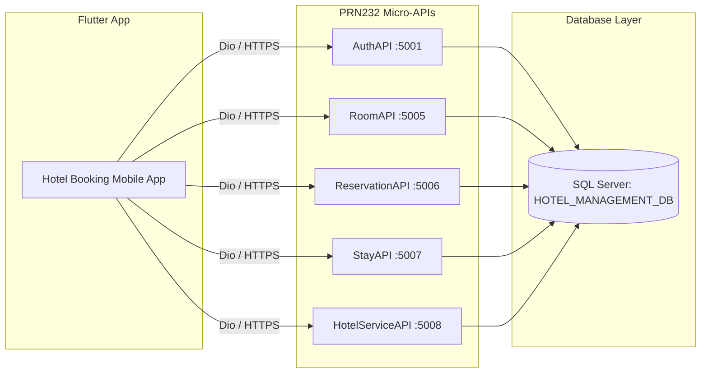

# Hotel Management & Booking Mobile App - PRM393

Dự án ứng dụng di động **Hotel Management & Booking (Quản lý và Đặt phòng khách sạn)** dành cho môn học **PRM393 (FPT University)**. Ứng dụng được xây dựng bằng **Flutter** theo kiến trúc chuẩn **Feature-First Clean Architecture**, kết nối với hệ thống Backend Micro-APIs **PRN232**.

---

## 🏛️ Kiến Trúc Tổng Quan Hệ Thống



---

## 📂 Cấu Trúc Repository

```text
hotel-mobile-prm393/
├── hotel_mobile_flutter/         # Mã nguồn ứng dụng Flutter Mobile Client
│   ├── lib/
│   │   ├── core/                 # Constants, Network (Dio), Storage, Routes (GoRouter), Theme, Widgets
│   │   └── features/             # auth, room, room_type, reservation, stay, hotel_service, task, profile
│   ├── pubspec.yaml              # Thư viện: flutter_riverpod, dio, go_router, flutter_secure_storage...
│   └── analysis_options.yaml     # Linter rules
│
└── hotel-management-docs/        # Tài liệu kiến trúc và quy chuẩn phát triển (bắt buộc tuân thủ)
    ├── developer_guide.md        # Hướng dẫn kiến trúc Clean Architecture, coding standards cho AI & Dev
    ├── hotel_booking_flow_guide.md # Sơ đồ luồng đặt phòng, lưu trú và tính hóa đơn chi tiết
    └── TEAM_TASKS.md             # Kế hoạch phân chia công việc & lộ trình Sprint
```

---

## 📱 Công Nghệ Sử Dụng (Mobile Client)

* **Architecture:** Clean Architecture (Feature-First: `data`, `domain`, `presentation`).
* **State Management:** Riverpod (`flutter_riverpod`, `riverpod_annotation`, `riverpod_generator`) + Freezed.
* **Networking:** `dio` kèm Auth Interceptor (tự động gắn Bearer Token & Auto Refresh Token).
* **Storage an toàn:** `flutter_secure_storage` lưu trữ JWT Token và Session.
* **Routing:** `go_router` hỗ trợ Declarative Routing và Route Guards (chặn khi chưa đăng nhập).
* **UI/UX:** Material 3, `cached_network_image`, responsive components.

---

## 🚀 Hướng Dẫn Cài Đặt & Chạy Ứng Dụng

### Bước 1: Clone Repository
```bash
git clone https://github.com/thpntmk471/hotel-mobile-prm393.git
cd hotel-mobile-prm393/hotel_mobile_flutter
```

### Bước 2: Cài đặt Dependencies & Sinh Code
```bash
flutter pub get
dart run build_runner build --delete-conflicting-outputs
```

### Bước 3: Khởi chạy Ứng dụng
```bash
flutter run
```

> [!TIP]
> - Nếu chạy bằng **Android Emulator**, cấu hình base host API mặc định trỏ về cổng ảo `http://10.0.2.2`.
> - Nếu chạy trên **Thiết bị thật (Real Device)**, cập nhật IP máy chủ phát WiFi trong file `lib/core/constants/api_constants.dart`.

---

## 📖 Tài Liệu Tham Khảo Chi Tiết
- [Hướng dẫn kiến trúc & Coding Standards cho AI / Dev](hotel-management-docs/developer_guide.md)
- [Sơ đồ chi tiết luồng Đặt phòng & Lưu trú](hotel-management-docs/hotel_booking_flow_guide.md)
- [Phân chia nhiệm vụ nhóm (Team Tasks)](hotel-management-docs/TEAM_TASKS.md)
