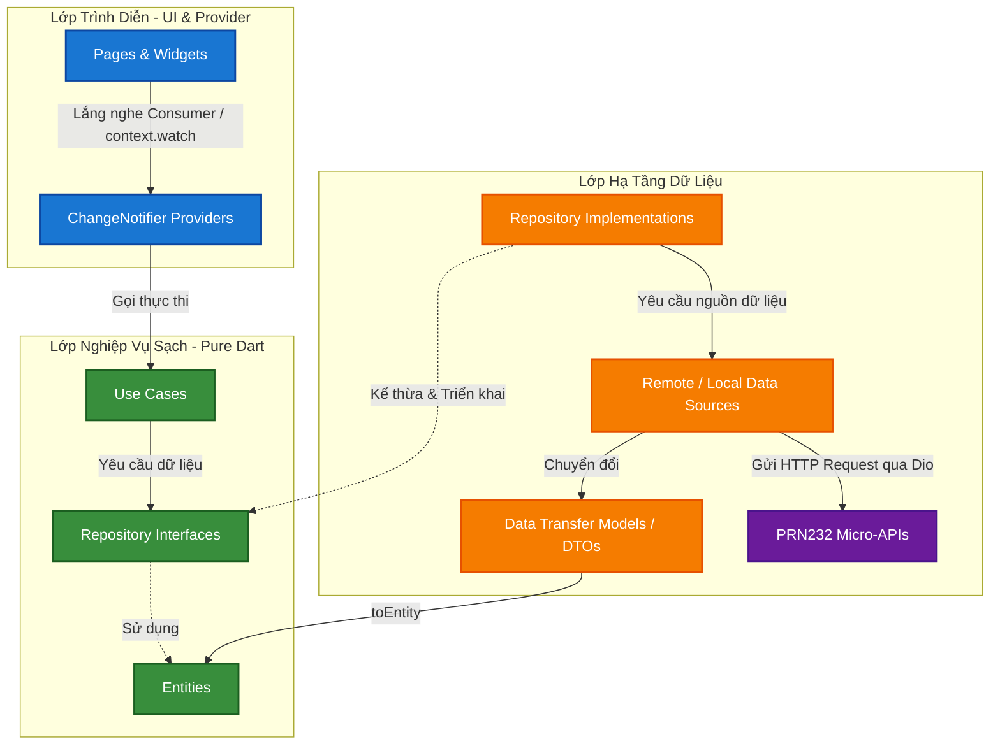

# Hướng Dẫn Kiến Trúc & Tiêu Chuẩn Lập Trình Dự Án Hotel Mobile (Developer & AI Coding Guide)

> [!IMPORTANT]
> Tài liệu này định nghĩa **quy chuẩn kiến trúc bắt buộc** cho dự án **Hotel Mobile App (PRM393)** kết nối với Backend **PRN232 Micro-APIs**.
> Hệ thống sử dụng State Management chuẩn giáo trình **`provider` (`ChangeNotifier`)**, tuân thủ nguyên tắc **Clean Architecture** phân chia theo Feature.
> Mọi lập trình viên và **AI Coding Assistant** khi tạo mới hoặc sửa đổi code trong dự án này **bắt buộc phải tuân thủ nghiêm ngặt** các nguyên tắc dưới đây.

---

## 🏗️ PHẦN I: KIẾN TRÚC TỔNG THỂ & RANH GIỚI TRÁCH NHIỆM

Hệ thống tuân thủ mô hình **Feature-First Clean Architecture**:



---

## 🚫 RANH GIỚI BẮT BUỘC GIỮA CÁC TẦNG (STRICT BOUNDARIES)

1. **Lớp Domain (Domain Layer - Pure Dart):**
   - **Tuyệt đối cấm** import bất kỳ thư viện bên thứ ba nào (như `dio`, `shared_preferences`, `provider`) hoặc các tệp từ `presentation/` và `data/`.
   - Các class `Entity` phải thuần khiết: **không** chứa hàm `fromJson`, `toJson`. Việc parse JSON thuộc trách nhiệm của Data Layer.
   - Chỉ chứa: `entities/`, `repositories/` (dưới dạng abstract class/interface) và `usecases/`.

2. **Lớp Data (Data Layer):**
   - Chịu trách nhiệm tương tác trực tiếp với API thông qua `DioClient` và lưu trữ cục bộ (`SharedPreferences`).
   - Các Model DTO tại `data/models/` đảm nhiệm serialize/deserialize JSON (`fromJson`, `toJson`).
   - **Bắt buộc:** Mọi hàm trong `Repository Implementation` phải chuyển đổi (map) Model DTO thành Entity của Domain bằng phương thức `.toEntity()` trước khi trả dữ liệu về.

3. **Lớp Presentation (Presentation Layer):**
   - **Tuyệt đối cấm** gọi trực tiếp các lớp trong `data/` (như Remote Data Source hay Dio).
   - Widget giao tiếp với State thông qua `Provider`: dùng `context.watch<T>()` để vẽ lại UI khi có thay đổi, hoặc `context.read<T>()` để gọi các hàm sự kiện (nhấn nút, nạp dữ liệu).
   - Sử dụng `Consumer<T>` cho các vùng UI nhỏ cần re-render tối ưu.

---

## 🌐 PHẦN II: CẤU HÌNH GIAO TIẾP VỚI PRN232 BACKEND MICRO-APIS

Mobile Client quản lý URL tập trung tại `core/constants/api_constants.dart`:

```dart
class ApiConstants {
  // Base host cho Android Emulator (10.0.2.2) hoặc Real Device / Localhost
  static const String host = 'http://10.0.2.2';

  // Cổng riêng cho từng Micro-API Service
  static const String authUrl = '$host:5001/api/Auth';
  static const String staffUrl = '$host:5002/api/Staff';
  static const String guestUrl = '$host:5003/api/Guest';
  static const String roomTypeUrl = '$host:5004/api/RoomType';
  static const String roomUrl = '$host:5005/api/Room';
  static const String reservationUrl = '$host:5006/api/Reservation';
  static const String stayUrl = '$host:5007/api/Stay';
  static const String hotelServiceUrl = '$host:5008/api/HotelService';
  static const String serviceUsageUrl = '$host:5009/api/ServiceUsage';
  static const String taskUrl = '$host:5010/api/Task';
  static const String reportUrl = '$host:5011/api/Report';
  static const String auditUrl = '$host:5012/api/Audit';
}
```

---

## 🛠️ PHẦN III: TIÊU CHUẨN CODE MẪU BẰNG PROVIDER (`ChangeNotifier`)

### 1. Domain Layer: Entity & Repository Interface

```dart
// lib/features/room/domain/entities/room.dart
class Room {
  final int id;
  final String roomNumber;
  final int roomTypeId;
  final String roomTypeName;
  final double pricePerNight;
  final String status; // Available, Occupied, Maintenance

  const Room({
    required this.id,
    required this.roomNumber,
    required this.roomTypeId,
    required this.roomTypeName,
    required this.pricePerNight,
    required this.status,
  });
}

// lib/features/room/domain/repositories/room_repository.dart
abstract class RoomRepository {
  Future<List<Room>> getAvailableRooms();
  Future<Room> getRoomById(int id);
}
```

### 2. Data Layer: Model DTO & Repository Implementation

```dart
// lib/features/room/data/models/room_model.dart
import '../../domain/entities/room.dart';

class RoomModel {
  final int id;
  final String roomNumber;
  final int roomTypeId;
  final String? roomTypeName;
  final double pricePerNight;
  final String status;

  RoomModel({
    required this.id,
    required this.roomNumber,
    required this.roomTypeId,
    this.roomTypeName,
    required this.pricePerNight,
    required this.status,
  });

  factory RoomModel.fromJson(Map<String, dynamic> json) {
    return RoomModel(
      id: json['id'] as int,
      roomNumber: json['roomNumber'] as String,
      roomTypeId: json['roomTypeId'] as int,
      roomTypeName: json['roomTypeName'] as String?,
      pricePerNight: (json['pricePerNight'] as num).toDouble(),
      status: json['status'] as String,
    );
  }

  // Chuyển đổi Model DTO tầng Data thành Entity thuần tầng Domain
  Room toEntity() {
    return Room(
      id: id,
      roomNumber: roomNumber,
      roomTypeId: roomTypeId,
      roomTypeName: roomTypeName ?? 'Tiêu chuẩn',
      pricePerNight: pricePerNight,
      status: status,
    );
  }
}

// lib/features/room/data/repositories/room_repository_impl.dart
import 'package:dio/dio.dart';
import '../../../../core/constants/api_constants.dart';
import '../../domain/entities/room.dart';
import '../../domain/repositories/room_repository.dart';
import '../models/room_model.dart';

class RoomRepositoryImpl implements RoomRepository {
  final Dio dio;
  RoomRepositoryImpl(this.dio);

  @override
  Future<List<Room>> getAvailableRooms() async {
    final response = await dio.get('${ApiConstants.roomUrl}/available');
    final data = response.data as List;
    final models = data.map((json) => RoomModel.fromJson(json as Map<String, dynamic>)).toList();
    return models.map((m) => m.toEntity()).toList();
  }

  @override
  Future<Room> getRoomById(int id) async {
    final response = await dio.get('${ApiConstants.roomUrl}/$id');
    final model = RoomModel.fromJson(response.data as Map<String, dynamic>);
    return model.toEntity();
  }
}
```

### 3. Presentation Layer: State Management với `ChangeNotifier` (Provider)

```dart
// lib/features/room/presentation/providers/room_provider.dart
import 'package:flutter/foundation.dart';
import '../../domain/entities/room.dart';
import '../../domain/repositories/room_repository.dart';

class RoomProvider extends ChangeNotifier {
  final RoomRepository roomRepository;

  RoomProvider({required this.roomRepository});

  List<Room> _rooms = [];
  bool _isLoading = false;
  String? _errorMessage;

  List<Room> get rooms => _rooms;
  bool get isLoading => _isLoading;
  String? get errorMessage => _errorMessage;

  Future<void> fetchAvailableRooms() async {
    _isLoading = true;
    _errorMessage = null;
    notifyListeners(); // Báo UI bật loading indicator

    try {
      _rooms = await roomRepository.getAvailableRooms();
    } catch (e) {
      _errorMessage = 'Không thể tải danh sách phòng: $e';
    } finally {
      _isLoading = false;
      notifyListeners(); // Báo UI hiển thị kết quả hoặc báo lỗi
    }
  }
}
```

### 4. Presentation Layer: UI Screen với `Consumer` / `context.watch`

```dart
// lib/features/room/presentation/pages/room_list_page.dart
import 'package:flutter/material.dart';
import 'package:provider/provider.dart';
import '../providers/room_provider.dart';

class RoomListPage extends StatefulWidget {
  const RoomListPage({super.key});

  @override
  State<RoomListPage> createState() => _RoomListPageState();
}

class _RoomListPageState extends State<RoomListPage> {
  @override
  void initState() {
    super.initState();
    // Gọi tải dữ liệu sau khi frame đầu tiên render xong
    WidgetsBinding.instance.addPostFrameCallback((_) {
      context.read<RoomProvider>().fetchAvailableRooms();
    });
  }

  @override
  Widget build(BuildContext context) {
    return Scaffold(
      appBar: AppBar(title: const Text('Danh Sách Phòng Khách Sạn')),
      body: Consumer<RoomProvider>(
        builder: (context, provider, child) {
          if (provider.isLoading) {
            return const Center(child: CircularProgressIndicator());
          }
          if (provider.errorMessage != null) {
            return Center(child: Text(provider.errorMessage!));
          }
          if (provider.rooms.isEmpty) {
            return const Center(child: Text('Hiện tại không có phòng trống.'));
          }

          return ListView.builder(
            itemCount: provider.rooms.length,
            itemBuilder: (context, index) {
              final room = provider.rooms[index];
              return ListTile(
                title: Text('Phòng ${room.roomNumber} - ${room.roomTypeName}'),
                subtitle: Text('Giá: ${room.pricePerNight} VNĐ / đêm'),
                trailing: Chip(
                  label: Text(room.status),
                  backgroundColor: room.status == 'Available' ? Colors.green[100] : Colors.grey[200],
                ),
              );
            },
          );
        },
      ),
    );
  }
}
```

---

## 🔒 QUY TẮC BẢO MẬT & QUẢN LÝ PHIÊN (AUTH & TOKEN)

1. **Lưu Token an toàn:** Access Token và Refresh Token được lưu trong `FlutterSecureStorage`, thông tin cấu hình người dùng (Theme, thông báo) lưu trong `SharedPreferences`.
2. **Auth Interceptor tự động:** Cấu hình Dio Interceptor tự động đính kèm header `Authorization: Bearer <token>` cho mọi request gọi đến các Micro-API cần xác thực.
3. **Xử lý 401 Unauthorized:** Khi nhận HTTP 401, tự động kích hoạt cơ chế Refresh Token với `PRN232.AuthAPI`. Nếu thất bại, xóa token và điều hướng về trang đăng nhập.
