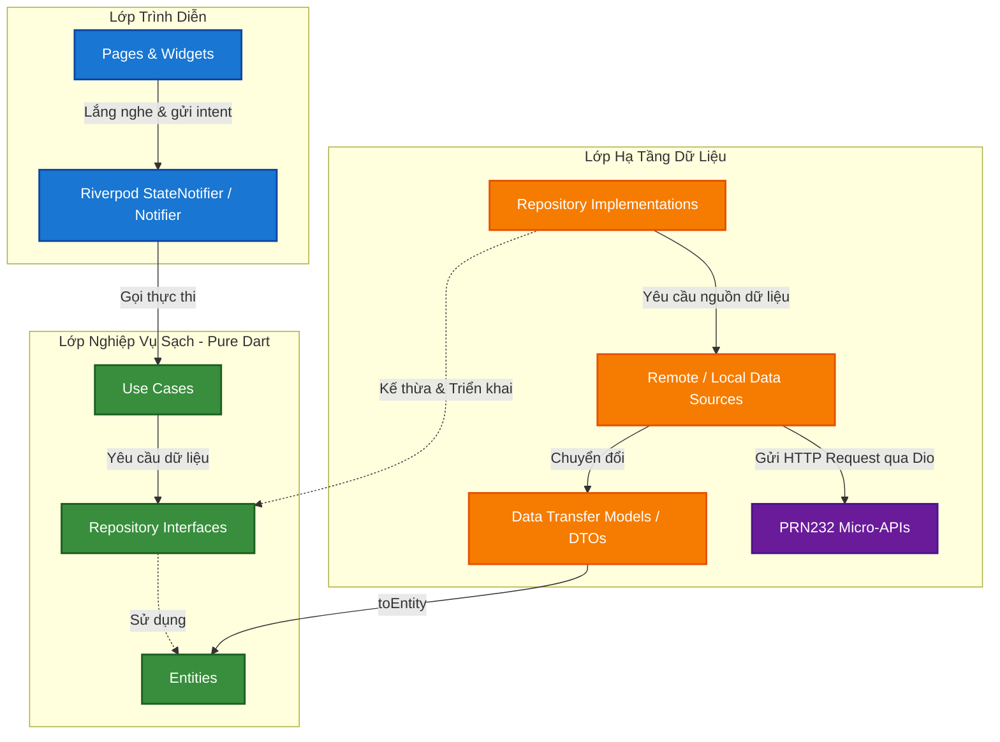

# Hướng Dẫn Kiến Trúc & Tiêu Chuẩn Lập Trình Dự Án Hotel Mobile (Developer & AI Coding Guide)

> [!IMPORTANT]
> Tài liệu này định nghĩa **quy chuẩn kiến trúc bắt buộc** cho dự án **Hotel Mobile App (PRM393)** kết nối với Backend **PRN232 Micro-APIs**.
> Mọi lập trình viên và **AI Coding Assistant** khi tạo mới hoặc sửa đổi code trong dự án này **bắt buộc phải tuân thủ nghiêm ngặt** các nguyên tắc dưới đây.

---

## 🏗️ PHẦN I: KIẾN TRÚC TỔNG THỂ & RANH GIỚI TRÁCH NHIỆM

Hệ thống tuân thủ mô hình **Feature-First Clean Architecture**:



---

## 🚫 RANH GIỚI BẮT BUỘC GIỮA CÁC TẦNG (STRICT BOUNDARIES)

1. **Lớp Domain (Domain Layer - Pure Dart):**
   - **Tuyệt đối cấm** import bất kỳ thư viện bên thứ ba nào (như `dio`, `flutter_secure_storage`, `riverpod`) hoặc các tệp từ `presentation/` và `data/`.
   - Các class `Entity` phải thuần khiết: **không** chứa hàm `fromJson`, `toJson`. Việc parse JSON thuộc trách nhiệm của Data Layer.
   - Chỉ chứa: `entities/`, `repositories/` (dưới dạng abstract class/interface) và `usecases/`.

2. **Lớp Data (Data Layer):**
   - Chịu trách nhiệm tương tác trực tiếp với API thông qua `DioClient`.
   - Các Model DTO tại `data/models/` đảm nhiệm serialize/deserialize JSON (`fromJson`, `toJson`).
   - **Bắt buộc:** Mọi hàm trong `Repository Implementation` phải chuyển đổi (map) Model DTO thành Entity của Domain bằng hàm extension hoặc method `.toEntity()` trước khi trả dữ liệu về.

3. **Lớp Presentation (Presentation Layer):**
   - **Tuyệt đối cấm** gọi trực tiếp các lớp trong `data/` (như Data Source hay Repo Implementation).
   - Widget chỉ giao tiếp với ViewModel/Provider thông qua `ref.watch()`, `ref.read()`.
   - Mọi State phải là **Immutable** (sử dụng `Freezed` hoặc `@immutable` của Riverpod Generator).

---

## 🌐 PHẦN II: TỔ CHỨC GIAO TIẾP VỚI PRN232 BACKEND MICRO-APIS

Hệ thống Backend PRN232 gồm **12 Microservices độc lập**, do đó Mobile Client quản lý URL tập trung tại `core/constants/api_constants.dart`:

```dart
class ApiConstants {
  // Base host cho Android Emulator (10.0.2.2) hoặc Real Device / Localhost
  static const String host = 'http://10.0.2.2';

  // Cổng riêng cho từng Micro-API Service
  static const String authUrl = '$host:5001/api/Auth';
  static const String staffUrl = '$host:5002/api/Staff';
  static const String guestUrl = '$host:5003/api/Guest';
  static const String roomTypeUrl = '$host:5004/api/RoomType';
  static const String roomUrl = '$host:5005/api/Room';
  static const String reservationUrl = '$host:5006/api/Reservation';
  static const String stayUrl = '$host:5007/api/Stay';
  static const String hotelServiceUrl = '$host:5008/api/HotelService';
  static const String serviceUsageUrl = '$host:5009/api/ServiceUsage';
  static const String taskUrl = '$host:5010/api/Task';
  static const String reportUrl = '$host:5011/api/Report';
  static const String auditUrl = '$host:5012/api/Audit';
}
```

---

## 🛠️ PHẦN III: TIÊU CHUẨN CODE MẪU THEO TỪNG THÀNH PHẦN

### 1. Domain Layer: Entity & Repository Interface

```dart
// lib/features/room/domain/entities/room.dart
class Room {
  final int id;
  final string roomNumber;
  final int roomTypeId;
  final String roomTypeName;
  final double pricePerNight;
  final String status; // Available, Occupied, Maintenance

  const Room({
    required this.id,
    required this.roomNumber,
    required this.roomTypeId,
    required this.roomTypeName,
    required this.pricePerNight,
    required this.status,
  });
}

// lib/features/room/domain/repositories/room_repository.dart
abstract class RoomRepository {
  Future<List<Room>> getAvailableRooms({DateTime? checkIn, DateTime? checkOut, int? roomTypeId});
  Future<Room> getRoomById(int id);
}
```

### 2. Data Layer: Model DTO & Mapper

```dart
// lib/features/room/data/models/room_model.dart
import '../../domain/entities/room.dart';

class RoomModel {
  final int id;
  final String roomNumber;
  final int roomTypeId;
  final String? roomTypeName;
  final double pricePerNight;
  final String status;

  RoomModel({
    required this.id,
    required this.roomNumber,
    required this.roomTypeId,
    this.roomTypeName,
    required this.pricePerNight,
    required this.status,
  });

  factory RoomModel.fromJson(Map<String, dynamic> json) {
    return RoomModel(
      id: json['id'] as int,
      roomNumber: json['roomNumber'] as String,
      roomTypeId: json['roomTypeId'] as int,
      roomTypeName: json['roomTypeName'] as String?,
      pricePerNight: (json['pricePerNight'] as num).toDouble(),
      status: json['status'] as String,
    );
  }

  // Chuyển đổi Model tầng Data thành Entity tầng Domain
  Room toEntity() {
    return Room(
      id: id,
      roomNumber: roomNumber,
      roomTypeId: roomTypeId,
      roomTypeName: roomTypeName ?? 'Standard',
      pricePerNight: pricePerNight,
      status: status,
    );
  }
}
```

### 3. Data Layer: Repository Implementation & Data Source

```dart
// lib/features/room/data/datasources/room_remote_datasource.dart
import 'package:dio/dio.dart';
import '../../../../core/constants/api_constants.dart';
import '../models/room_model.dart';

abstract class RoomRemoteDataSource {
  Future<List<RoomModel>> fetchAvailableRooms();
}

class RoomRemoteDataSourceImpl implements RoomRemoteDataSource {
  final Dio dio;
  RoomRemoteDataSourceImpl(this.dio);

  @override
  Future<List<RoomModel>> fetchAvailableRooms() async {
    final response = await dio.get('${ApiConstants.roomUrl}/available');
    final list = response.data as List;
    return list.map((e) => RoomModel.fromJson(e as Map<String, dynamic>)).toList();
  }
}

// lib/features/room/data/repositories/room_repository_impl.dart
import '../../domain/entities/room.dart';
import '../../domain/repositories/room_repository.dart';
import '../datasources/room_remote_datasource.dart';

class RoomRepositoryImpl implements RoomRepository {
  final RoomRemoteDataSource remoteDataSource;
  RoomRepositoryImpl(this.remoteDataSource);

  @override
  Future<List<Room>> getAvailableRooms({DateTime? checkIn, DateTime? checkOut, int? roomTypeId}) async {
    final models = await remoteDataSource.fetchAvailableRooms();
    return models.map((m) => m.toEntity()).toList();
  }

  @override
  Future<Room> getRoomById(int id) async {
    throw UnimplementedError();
  }
}
```

### 4. Presentation Layer: State & Riverpod Provider

```dart
// lib/features/room/presentation/providers/room_state.dart
import 'package:freezed_annotation/freezed_annotation.dart';
import '../../domain/entities/room.dart';

part 'room_state.freezed.dart';

@freezed
class RoomState with _$RoomState {
  const factory RoomState.initial() = _Initial;
  const factory RoomState.loading() = _Loading;
  const factory RoomState.loaded(List<Room> rooms) = _Loaded;
  const factory RoomState.error(String message) = _Error;
}

// lib/features/room/presentation/providers/room_notifier.dart
import 'package:flutter_riverpod/flutter_riverpod.dart';
import '../../domain/usecases/get_available_rooms_usecase.dart';
import 'room_state.dart';

class RoomNotifier extends StateNotifier<RoomState> {
  final GetAvailableRoomsUseCase getAvailableRoomsUseCase;

  RoomNotifier(this.getAvailableRoomsUseCase) : super(const RoomState.initial());

  Future<void> loadRooms() async {
    state = const RoomState.loading();
    try {
      final rooms = await getAvailableRoomsUseCase();
      state = RoomState.loaded(rooms);
    } catch (e) {
      state = RoomState.error(e.toString());
    }
  }
}
```

---

## 🔒 QUY TẮC BẢO MẬT & QUẢN LÝ PHIÊN (AUTH & TOKEN)

1. **Lưu Token an toàn:** Mọi Access Token và Refresh Token **bắt buộc** phải lưu trong `FlutterSecureStorage` (tại `core/storage/secure_storage_service.dart`).
2. **Auth Interceptor tự động:** Cấu hình Dio Interceptor tự động đính kèm header:
   `Authorization: Bearer <token>` cho mọi request gọi đến các Micro-API cần xác thực.
3. **Xử lý 401 Unauthorized:** Khi nhận HTTP 401, Interceptor kích hoạt cơ chế Refresh Token với `PRN232.AuthAPI`. Nếu thất bại, xóa token và điều hướng người dùng về màn hình đăng nhập qua `GoRouter`.

