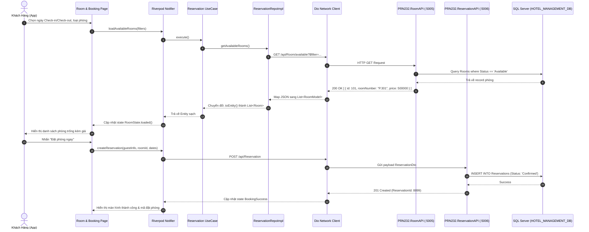
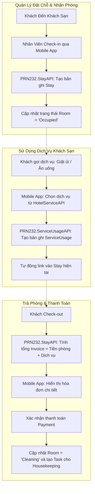

# Luồng Nghiệp Vụ Đặt Phòng Khách Sạn (Hotel Booking & Stay Flow)
## Từ Backend PRN232 Đến Giao Diện Flutter Mobile

Tài liệu này mô tả chi tiết quy trình xử lý dữ liệu của 2 luồng quan trọng nhất trong ứng dụng:
1. **Luồng Tìm kiếm & Đặt phòng (Guest Booking Flow)**
2. **Luồng Nhận phòng, Dịch vụ & Trả phòng (Check-in, Room Service & Check-out Flow)**

---

## 📊 1. SƠ ĐỒ LUỒNG ĐẶT PHÒNG (BOOKING FLOW DIAGRAM)



---

## 📊 2. SƠ ĐỒ LUỒNG LƯU TRÚ & SỬ DỤNG DỊCH VỤ (STAY & SERVICE USAGE)



---

## 🔍 CHI TIẾT CÁC BƯỚC TRIỂN KHAI THEO LAYER TRÊN FLUTTER

### Bước 1: Gọi API tìm phòng (Presentation -> Network)
- **File UI:** `features/room/presentation/pages/room_list_page.dart`
- Người dùng chọn bộ lọc: Ngày nhận, Ngày trả, Loại phòng (`roomTypeId`).
- **Provider:** `room_notifier.dart` kích hoạt `fetchAvailableRooms`.
- **Dio Client:** Gửi query string qua `ApiConstants.roomUrl`.

### Bước 2: Nhận dữ liệu & Chuyển đổi Model sang Entity
- **File Model:** `features/room/data/models/room_model.dart`
  - Nhận JSON từ `PRN232.RoomAPI`.
  - Kiểm tra trường null an toàn, parse kiểu số sang double / int.
- **File Entity:** `features/room/domain/entities/room.dart`
  - Chuyển đổi qua phương thức:
    ```dart
    Room entity = roomModel.toEntity();
    ```

### Bước 3: Tạo đơn đặt chỗ (Reservation)
- **File Page:** `features/reservation/presentation/pages/booking_checkout_page.dart`
- Đóng gói dữ liệu đặt phòng:
  - `guestId`: Lấy từ phiên đăng nhập hiện tại (`AuthNotifier`).
  - `roomId`: Phòng đã chọn.
  - `checkInDate`, `checkOutDate`: Thời gian lưu trú.
- Gửi POST tới `ApiConstants.reservationUrl`.

### Bước 4: Gọi dịch vụ phòng (Hotel Services)
- Khách hàng có thể đặt thêm dịch vụ (Ăn uống, nước uống, spa) từ màn hình:
  `features/hotel_service/presentation/pages/service_catalog_page.dart`.
- App gửi request tới `PRN232.ServiceUsageAPI`, tự động gắn kèm mã `StayId` đang hoạt động của khách.

### Bước 5: Xem Hóa Đơn & Check-out (Stay & Invoices)
- Màn hình `features/stay/presentation/pages/stay_detail_page.dart` hiển thị:
  1. Chi phí tiền phòng theo số đêm.
  2. Chi tiết các dịch vụ đã sử dụng trong suốt kỳ nghỉ (`InvoiceLine`).
  3. Tổng tiền thanh toán và phương thức (Tiền mặt, VNPay/Chuyển khoản, Thẻ).

