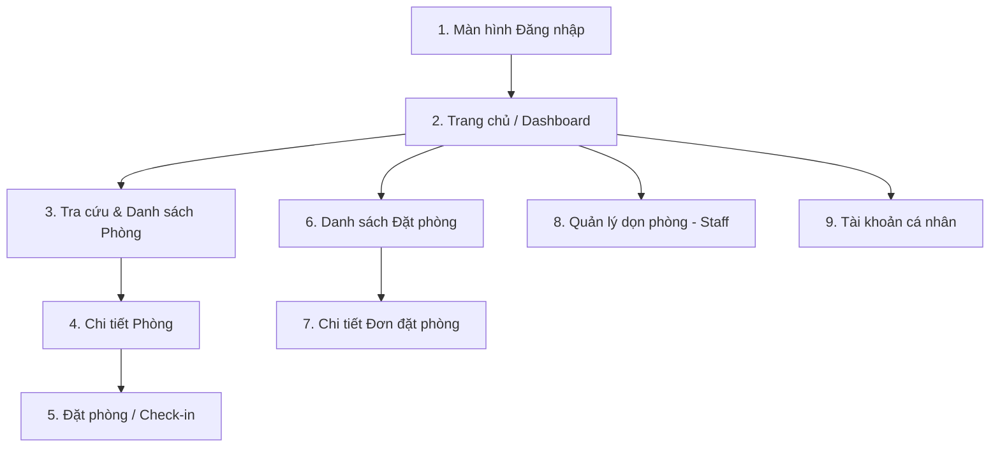

# Hướng Dẫn Thiết Kế Giao Diện Mobile App (Mobile UI/UX Design Guide)
## PRM393 - Hotel Booking & Management Mobile App

> [!IMPORTANT]
> Tài liệu này định nghĩa **quy chuẩn thiết kế giao diện (UI/UX)** cho ứng dụng di động Flutter.
> Giao diện Mobile được đồng bộ hoàn toàn với hệ thống Web Backend (PRN232) về **màu sắc chủ đạo (Brand Color)**, **trạng thái (Status Tags)**, và **luồng nghiệp vụ cốt lõi**.
> Lập trình viên và AI Coding Assistant **phải tuân thủ** các hướng dẫn bố cục, màu sắc và component bên dưới để đảm bảo đạt điểm tối đa ở tiêu chí **UI/UX (15%)** và **Business Logic (50%)**.

---

## 🎨 1. BẢNG MÀU CHỦ ĐẠO & PHONG CÁCH THIẾT KẾ (DESIGN SYSTEM)

Lấy cảm hứng từ giao diện Web Hotel Management (PRN232) hiện tại:

```dart
// lib/core/theme/app_colors.dart
import 'package:flutter/material.dart';

class AppColors {
  // Màu thương hiệu chính (Deep Emerald Green - đồng bộ với Web)
  static const Color primary = Color(0xFF1B5E4F);       // Xanh ngọc đậm (Nút chính, AppBar, Header)
  static const Color primaryLight = Color(0xFFE8F2EF);  // Xanh nền nhạt (Highlight card, active tab)
  static const Color primaryDark = Color(0xFF123F35);

  // Nền & Chữ
  static const Color background = Color(0xFFF8F9FA);    // Nền xám rất nhạt, sang trọng
  static const Color surface = Colors.white;            // Nền thẻ card, form trắng
  static const Color textPrimary = Color(0xFF1F2937);   // Chữ tiêu đề đậm
  static const Color textSecondary = Color(0xFF6B7280); // Chữ mô tả, label phụ
  static const Color border = Color(0xFFE5E7EB);        // Viền input, viền divider

  // Màu trạng thái phòng & đơn đặt (Status Chips - Đồng bộ 100% với Web)
  static const Color statusActiveBg = Color(0xFFDCFCE7);    // Xanh lá nhạt
  static const Color statusActiveText = Color(0xFF15803D);  // Hoạt động / Đã nhận phòng / Sạch

  static const Color statusWarningBg = Color(0xFFFEF3C7);   // Vàng cam nhạt
  static const Color statusWarningText = Color(0xFFB45309); // Cần dọn / Đang chờ duyệt

  static const Color statusBlueBg = Color(0xFFDBEAFE);      // Xanh dương nhạt
  static const Color statusBlueText = Color(0xFF1D4ED8);    // Đã xác nhận / Đặt trước

  static const Color statusGrayBg = Color(0xFFF3F4F6);      // Xám nhạt
  static const Color statusGrayText = Color(0xFF4B5563);    // Đã trả phòng / Bảo trì
}
```

---

## 📱 2. DANH SÁCH MÀN HÌNH CHÍNH & BỐ CỤC (CORE SCREENS)

Ứng dụng hướng đến sự **tinh gọn, trực quan, dễ dùng trên điện thoại**, gồm 5 nhóm màn hình chính:



---

### MÀN HÌNH 1: ĐĂNG NHẬP (`LoginScreen`)
* **Mục tiêu:** Cho phép khách hàng hoặc nhân viên (Lễ tân, Buồng phòng) đăng nhập vào hệ thống.
* **Bố cục:**
  - Header: Logo Khách sạn (`HM` logo nền đen bo góc, chữ trắng).
  - Tiêu đề: *"Đăng nhập - Nhập thông tin tài khoản để truy cập hệ thống"*.
  - Form Fields:
    - `Tên đăng nhập` (Input viền xám, bo góc 8px).
    - `Mật khẩu` (Input kèm nút icon con mắt "Hiện/Ẩn" mật khẩu).
  - Nút bấm chính: **"Đăng nhập"** (Nút màu xanh `AppColors.primary`, chữ trắng, bo góc 8px).
  - Tài khoản mẫu gợi ý hiển thị bên dưới (ví dụ: `demo.reception / 123456`) giúp giáo viên chấm bài đăng nhập được ngay.

---

### MÀN HÌNH 2: TRANG CHỦ / ĐIỀU HƯỚNG (`HomeScreen`)
* **Bố cục:**
  - **Header:** Lời chào cá nhân hóa *"Xin chào, Lễ tân Demo"* kèm Tag vai trò (`● Receptionist` màu xanh).
  - **Banner / Quick Action Cards:**
    - 🛏️ **Quản lý phòng:** Xem tình trạng phòng, số phòng trống hôm nay.
    - 📅 **Đặt phòng:** Tạo đơn đặt phòng mới, duyệt đơn.
    - 🧹 **Buồng phòng:** Danh sách phòng cần dọn dẹp.
  - **Bottom Navigation Bar (Thanh điều hướng dưới đáy):**
    1. Trang chủ (Home)
    2. Phòng (Rooms)
    3. Đơn đặt (Bookings)
    4. Cá nhân (Profile)

---

### MÀN HÌNH 3: DANH SÁCH PHÒNG & BỘ LỌC (`RoomListPage`)
*(Bám sát giao diện bảng Room trên Web)*
* **Bộ lọc nhanh (Horizontal Filter Chips):**
  - Loại phòng: *Tất cả*, *Phòng Standard*, *Phòng Deluxe*, *Phòng VIP*.
  - Trạng thái: *Tất cả*, *Sạch*, *Cần dọn*.
* **Danh sách phòng (Card view tối ưu mobile thay vì Table ngang):**
  - Mỗi phòng là 1 thẻ `Card` bo góc:
    - **Header Card:** Mã phòng in đậm (ví dụ: `DEV-101`, `DEV-201`), số tầng (`Tầng 1`, `Tầng 2`).
    - **Body:** Tên loại phòng, Giá tiền/đêm (định dạng VND: `500.000 VNĐ`).
    - **Status Chips:**
      - Chip Hoạt động: `● Hoạt động` (xanh lá).
      - Chip Tình trạng: `● Sạch` (xanh lá) hoặc `● Cần dọn` (màu vàng cam).
    - **Thao tác:** Nút *"Chi tiết"* và *"Đặt phòng"*.

---

### MÀN HÌNH 4: ĐẶT PHÒNG (`BookingScreen` / `ReservationScreen`)
*(Nơi thể hiện 50% điểm Business Logic / Rules)*
* **Form nhập liệu chuẩn:**
  1. **Chọn ngày lưu trú:**
     - `Từ ngày (Check-in)` & `Đến ngày (Check-out)` (Dùng `showDatePicker`).
     - **Rule bắt buộc:** Không cho chọn ngày trong quá khứ; Ngày Check-out phải sau ngày Check-in.
  2. **Chọn phòng:** Dropdown hoặc chọn từ danh sách phòng trống.
  3. **Thông tin khách hàng:** Tên khách, Số điện thoại (Validate định dạng 10 số), CCCD/Passport.
  4. **Số lượng khách:** Bắt buộc $\ge 1$ và không vượt quá sức chứa của loại phòng.
  5. **Bảng tóm tắt chi phí (Cost Summary):**
     - Tiền phòng = Đơn giá $\times$ Số đêm.
     - Dịch vụ thêm (nếu có).
     - **Tổng tiền thanh toán** (In đậm to rõ).
  6. **Nút hành động:** **"Xác nhận đặt phòng"** (Disable nếu form chưa hợp lệ).

---

### MÀN HÌNH 5: DANH SÁCH ĐƠN ĐẶT PHÒNG (`ReservationListPage`)
*(Bám sát dữ liệu bảng Quản lý Đặt phòng trên Web)*
* **Thanh tìm kiếm:** Tìm nhanh theo Mã đặt phòng (`RSV...`) hoặc Tên khách hàng.
* **Item hiển thị:**
  - Mã đơn: `RSV334E35DF4B` (Màu xanh đậm).
  - Tên khách: `Khách Test F07` - Số khách: `1 khách`.
  - Phòng: `F09TEST-101`.
  - Thời gian: `04/11/2026 -> 06/11/2026`.
  - Tổng tiền: `900.000 VNĐ`.
  - Tag trạng thái:
    - `Đã xác nhận` (Xanh dương).
    - `Đã nhận phòng` (Xanh lá).
    - `Đã trả phòng` (Xám).

---

## 🧩 3. COMMON WIDGETS CẦN DÙNG (TÁI SỬ DỤNG)

Để giữ code gọn và Clean Architecture, lập trình viên tạo sẵn các widget này trong `core/widgets/`:
1. **`CustomButton`:** Nút bấm màu xanh `AppColors.primary`, có hiệu ứng loading khi đang bấm gọi API.
2. **`CustomTextField`:** Ô nhập liệu viền xám, bo góc 8px, hiển thị label và câu báo lỗi đỏ rõ ràng.
3. **`StatusChip`:** Nhãn trạng thái tròn bo góc (`Sạch`, `Cần dọn`, `Đã xác nhận`...) tự đổi màu theo status string.
4. **`EmptyStateWidget`:** Hiển thị icon và câu thông báo khi danh sách phòng hoặc đơn đặt rỗng.

---

## 🎯 4. NGUYÊN TẮC TRẢI NGHIỆM NGƯỜI DÙNG (UX RULES ĐẠT ĐIỂM CAO)

1. **Luôn có Loading & Error Feedback:** Khi bấm nút hoặc tải danh sách, bắt buộc hiện `CircularProgressIndicator` hoặc Shimmer. Nếu lỗi mạng phải hiện `SnackBar` hoặc Dialog thân thiện, không để màn hình trắng xóa.
2. **Xác nhận thao tác nguy hiểm (Confirmation Dialog):** Khi Hủy phòng hoặc Check-out trả phòng, phải có hộp thoại *"Bạn có chắc chắn muốn hủy đặt phòng này?"*.
3. **Format tiền tệ & thời gian chuẩn Việt Nam:** Luôn hiển thị `500.000 VNĐ` (thay vì `500000`) và ngày dạng `dd/MM/yyyy`.

