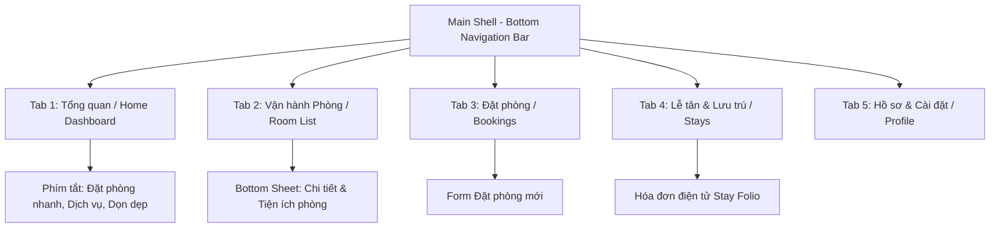

# Hướng Dẫn Thiết Kế Giao Diện Mobile App (Mobile UI/UX Design Guide)
## PRM393 - Hotel Booking & Management Mobile App
### Chuẩn Professional Product UI & Mobile Ergonomics (Đồng bộ với PromptUI)

> [!IMPORTANT]
> Tài liệu này chuẩn hóa toàn bộ thiết kế giao diện di động (Flutter Mobile App) theo triết lý **Senior Product UI — Anti-Generic AI Design** và **Mobile-First UX**.
> Ứng dụng phải mang lại trải nghiệm tiện dụng, tối ưu cho thao tác một tay (Thumb Zone), sử dụng cấu trúc **Main Shell với Bottom Navigation Bar**, thẻ thông tin phân cấp thị giác rõ ràng, và loại bỏ hoàn toàn các layout desktop/web gượng ép trên di động.

---

## 🎨 1. HỆ THỐNG MÀU SẮC & DESIGN TOKENS (DESIGN SYSTEM)

Kế thừa màu sắc nhận diện thương hiệu từ Web Backend (PRN232) nhưng tinh chỉnh tỷ lệ tương phản cho màn hình cảm ứng di động:

```dart
// lib/core/theme/app_colors.dart
import 'package:flutter/material.dart';

class AppColors {
  // Brand Color chính (Deep Emerald Green)
  static const Color primary = Color(0xFF1B5E4F);       // Xanh ngọc lục bảo đậm
  static const Color primaryLight = Color(0xFFE8F2EF);  // Nền xanh nhạt cho Pill, Chip, Active Tab
  static const Color primaryDark = Color(0xFF123F35);   // Xanh ngọc rất đậm cho AppBar ban đêm

  // Nền & Phân tách khối
  static const Color background = Color(0xFFF6F8FA);    // Xám nhạt dịu mắt, chống chói
  static const Color surface = Colors.white;            // Nền Card, Sheet, Modal
  static const Color border = Color(0xFFE5E7EB);        // Viền phân tách 1px mảnh
  static const Color divider = Color(0xFFF1F3F5);

  // Chữ & Typography Hierarchy
  static const Color textPrimary = Color(0xFF111827);   // Tiêu đề, số liệu chính
  static const Color textSecondary = Color(0xFF6B7280); // Nhãn mô tả phụ, caption
  static const Color textTertiary = Color(0xFF9CA3AF);  // Placeholder, timestamp

  // Trạng thái chuẩn nghiệp vụ khách sạn (Semantic Status)
  static const Color statusActiveBg = Color(0xFFDCFCE7);    // Sạch / Đang lưu trú / Đã hoàn tất
  static const Color statusActiveText = Color(0xFF15803D);

  static const Color statusWarningBg = Color(0xFFFEF3C7);   // Cần dọn / Đang chờ xử lý / Ưu tiên cao
  static const Color statusWarningText = Color(0xFFB45309);

  static const Color statusBlueBg = Color(0xFFDBEAFE);      // Đã xác nhận / Đặt trước
  static const Color statusBlueText = Color(0xFF1D4ED8);

  static const Color statusGrayBg = Color(0xFFF3F4F6);      // Đã trả phòng / Bảo trì
  static const Color statusGrayText = Color(0xFF4B5563);

  static const Color error = Color(0xFFEF4444);
}
```

### Quy tắc Spacing & Bo góc (Anti-Generic AI):
- **Spacing Token:** Dùng bội số `4 / 8 / 12 / 16 / 20 / 24 / 32 px`.
- **Bo góc (Corner Radius):**
  - Card & Container: `12px` hoặc `16px`.
  - Button & Input: `10px`.
  - Status Pill: `20px` (dạng viên thuốc).
  - *Tuyệt đối không bo góc quá lớn 30-40px trên mọi component.*
- **Độ đổ bóng (Shadow):** Rất nhẹ (`blurRadius: 8, color: Colors.black.withOpacity(0.04)`), không dùng shadow đen đặc hay neon glow.

---

## 📱 2. KIẾN TRÚC ĐIỀU HƯỚNG MOBILE (BOTTOM NAVIGATION SHELL)

Ứng dụng sử dụng cấu trúc **Main Shell** với **Bottom Navigation Bar 5 Tabs** chuẩn Mobile Ergonomics, giúp người dùng chuyển đổi các phân hệ chỉ với một chạm ngón cái:



### 1. Tab 1: Tổng quan (Home Dashboard - Bàn làm việc Lễ tân)
- **Top Bar:** Avatar cá nhân, Lời chào, Tag vai trò (`● Receptionist`), Tên cơ sở khách sạn (`PRM Grand Luxury Hotel`).
- **Operational KPI Carousel / Grid:** 4 thẻ đo lường vận hành trực tiếp từ hệ thống:
  - 🏠 **Phòng trống sẵn sàng:** `X/Y phòng`
  - 📈 **Tỷ lệ lấp đầy:** `... %`
  - 📥 **Lượt khách check-in hôm nay:** `... lượt`
  - 🧹 **Phòng cần dọn cấp thiết:** `... phòng`
- **Quick Action Row (Phím tắt tròn/vuông mềm chuẩn mobile):**
  - `+ Đặt phòng` • `📥 Nhận phòng` • `🛎️ Dịch vụ` • `🧹 Buồng phòng`
- **Hoạt động hôm nay (Today's Feed):** Danh sách lượt khách đang lưu trú và các tác vụ cần xử lý ngay trong ca trực.

### 2. Tab 2: Vận hành Phòng (Rooms)
- Thanh tìm kiếm và bộ lọc nhanh ngang (Tất cả, Standard, Deluxe, VIP).
- Thẻ phòng tối ưu mobile: Header rõ mã phòng (`DEV-101`), số tầng, sức chứa (`2 khách`), giá tiền VND in đậm, chip tình trạng dọn dẹp và nút bấm chuyển trạng thái trực tiếp.

### 3. Tab 3: Quản lý Đặt phòng (Bookings)
- Danh sách đơn đặt phòng (`RSV-...`).
- **Floating Action Button (FAB):** Nút tròn nổi `+ Đặt phòng` ở góc dưới bên phải màn hình để tạo đơn nhanh.
- Nút bấm trực tiếp trên từng thẻ: "Check-in nhận phòng" chuyển đổi ngay sang trạng thái lưu trú.

### 4. Tab 4: Lễ tân & Lưu trú (Stays)
- Danh sách các phòng đang có khách ở thực tế (`STY-...`).
- Xem chi tiết hóa đơn (Hotel Folio Invoice) gồm tiền phòng, dịch vụ minibar phát sinh và modal thanh toán (Tiền mặt / VNPay QR / Thẻ).

### 5. Tab 5: Hồ sơ & Cài đặt (Profile)
- Quản lý ca trực, thông tin liên hệ, công tắc chuyển đổi Chế độ tối (Dark Mode) thời gian thực và đăng xuất an toàn.

---

## 🛠️ 3. QUY TẮC FORM & THAO TÁC CẢM ỨNG (MOBILE UX RULES)

1. **Vùng chạm tối thiểu (Touch Target):** Mọi nút bấm, icon bấm được đều có kích thước tối thiểu $44 \times 44$ pt.
2. **Sticky Bottom Action Bar:** Trong form đặt phòng và thanh toán hóa đơn, thanh tóm tắt tổng tiền và nút bấm chính luôn được **ghim cố định ở chân màn hình** (`BottomAppBar` hoặc `Container` kèm `SafeArea`), người dùng không cần phải cuộn hết form mới bấm được nút.
3. **Pull-to-Refresh:** Tất cả các danh sách đều hỗ trợ vuốt xuống để tải lại dữ liệu mới nhất (`RefreshIndicator`).
4. **Bottom Sheet thay cho Modal nhỏ:** Trên thiết bị di động, ưu tiên mở Bottom Sheet trượt từ dưới lên để xem chi tiết phòng, bộ lọc nâng cao hoặc chọn phương thức thanh toán.
5. **Xác nhận an toàn (Destructive Action):** Thao tác trả phòng hoặc hủy đơn bắt buộc có hộp thoại xác nhận với 2 nút có thứ bậc thị giác rõ ràng (Hủy: xám nhạt, Đồng ý: màu cảnh báo).
